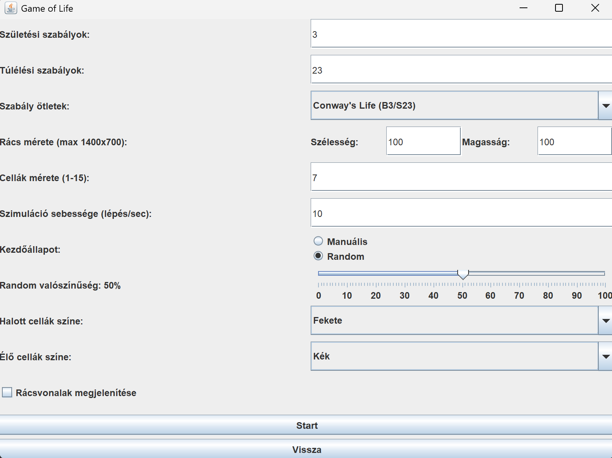
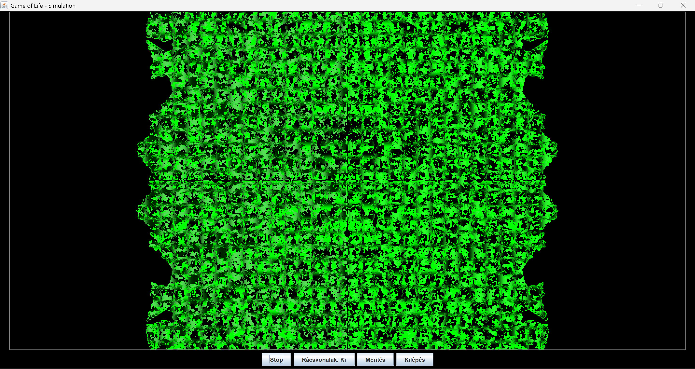
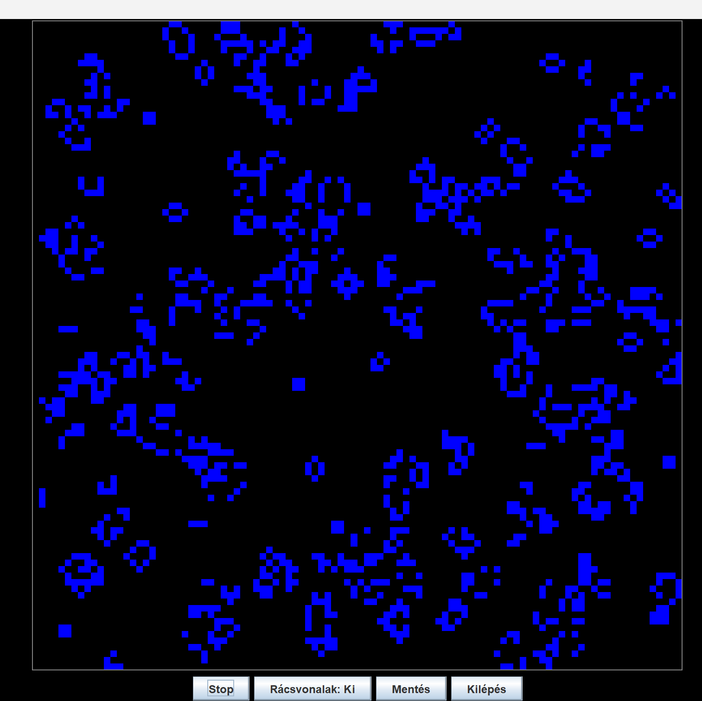

# Game of Life – Java Simulation

A graphical cellular automaton simulator developed in Java as a university programming project at the Budapest University of Technology and Economics (BME).

The application is based on Conway's Game of Life, but supports configurable birth and survival rules, allowing other Life-like cellular automata to be simulated as well.

It provides a graphical user interface for configuring, running, saving and loading simulations.

## Screenshots

### Simulation settings



### Running simulation

 


## Features

- Graphical user interface built with Java Swing
- Configurable birth and survival rules
- Conway's Game of Life (`B3/S23`) as a predefined rule set
- Configurable grid dimensions
- Adjustable cell size
- Adjustable simulation speed
- Manual or randomized initial state
- Configurable probability for random initialization
- Custom colors for alive and dead cells
- Optional grid lines
- Start and stop simulation controls
- Save simulations to files
- Load previously saved simulations
- Input validation and error handling

## Architecture

The application is divided into several packages with separate responsibilities:

- `controller` – connects the user interface with the simulation logic
- `grid` – represents and manages the cellular grid
- `simulation` – handles the simulation process
- `save` – provides simulation saving and loading
- `ui` – contains the Swing-based graphical user interface
- `util` – utility classes for rules and colors

This separation keeps the simulation logic, persistence and user interface independent from each other.

## Testing

The project contains automated tests using JUnit 5.

The test suite covers the main components of the application, including:

- grid behavior
- simulation logic
- controller functionality
- simulation saving and loading

Run the tests with:

```bash
mvn test
```

The current test suite contains **14 tests**, all of which pass successfully.

## Requirements

- Java 22
- Maven

## Building

Clone the repository and build the project using Maven:

```bash
mvn clean package
```

This also runs the automated test suite.

## Running

Compile the application:

```bash
mvn compile
```

Then run the main class:

```bash
java -cp target/classes gameoflife.ui.AppFrame
```

## Project Structure

```text
src/
├── main/
│   ├── java/gameoflife/
│   │   ├── controller/
│   │   ├── grid/
│   │   ├── save/
│   │   ├── simulation/
│   │   ├── ui/
│   │   └── util/
│   └── resources/
│       └── saves/
└── test/
    └── java/
```

## Technologies

- Java
- Java Swing
- Maven
- JUnit 5
- Object-oriented programming
- File I/O
- Automated testing

## Documentation

Detailed Hungarian documentation is available in [`documentation-hu.pdf`](documentation-hu.pdf). It includes user documentation, the application structure, a class diagram, and detailed descriptions of the main classes and functionality.